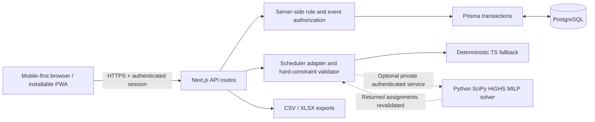

# BlueScale — Engineering Case Study

**Event staffing and fair scheduling | Full-stack engineering | Next.js 15 · TypeScript · PostgreSQL · Prisma · Python/SciPy**

**Engineer:** Diogo Abreu da Silva, Electronics Engineering undergraduate at UNIFEI (Brazil)

**Status:** working research/product candidate. Automated checks are passing for the stated commits; the public deployment is not evidence that the current repository SHA has been deployed or accepted by real users.

## 1. Problem and constraints

University events need to staff multiple positions and shifts while honoring people's availability, qualification requirements and workload limits. Spreadsheets make it easy to double-book someone, forget hard constraints or silently overwrite another organizer's changes.

The engineering objective was to centralize the workflow—members, events, workstations, availability, scheduling, publication, confirmation, attendance and substitution—in a shared multi-user application with **server-authoritative** state.

Scheduling must not quietly violate:

- A member's availability, active status and required skills.
- Overlapping shifts, minimum rest, total minutes or shifts per member.
- The maximum capacity of a workstation and explicit locked assignments.
- A coordinator's authorization for only their nominated events.

## 2. Architecture and boundaries



The user interface does not own the truth about saved schedules; the API validates roles and database state. A privately hosted Python optimizer can be configured for mixed-integer linear programming. When it is unavailable or returns invalid assignments, the TypeScript fallback runs. **Even the external optimizer's answer is checked against hard constraints before use.** This is a deliberate separation of optimization from safety.

### Design choices and trade-offs

| Risk | Engineering response | Trade-off |
| --- | --- | --- |
| Two organizers overwrite each other's changes | Numeric revisions, `SERIALIZABLE` transactions, compare-and-swap update and HTTP 409 for stale clients | Users must refresh after genuine conflicts |
| PostgreSQL aborts a concurrent transaction | Retry only fully rolled-back Prisma `P2034` serialization failures, with bounded backoff | More robust under contention without retrying business-rule failures |
| A coordinator tries to inspect another event | Server checks explicit `EventCoordinator` mapping on **every event-scoped read** | Access is intentionally narrower than a global coordinator role |
| Coordinator permission is revoked after login | Server consults live database authorization, not only session claims | Additional database reads per guarded request |
| Optimizer fails, times out, or breaks constraints | Deterministic fallback and independent validator | Fallback is **not** claimed to find a global optimum |
| Published schedule requires corrections | Create a draft while preserving published assignments and attendance | More explicit versions to manage |
| Exported data is opened in a spreadsheet | Escape CSV formula-like payloads; exclude unnecessary sensitive fields from member views | Less data available to lower-privilege clients |

## 3. Verification evidence

### Continuous integration, as of 22 Nov 2026

The [GitHub Actions workflow](../.github/workflows/ci.yml) provisions a **temporary PostgreSQL 16 service**, applies migrations, bootstraps the administrator twice to check idempotency, creates test fixtures and executes:

- Next.js type checking, linting and production build.
- Core scheduling, security, release, and mobile/PWA checks.
- **20 Playwright browser E2E tests** with real Next.js API and CI PostgreSQL, including two concurrent editors and a coordinator's event-scope/revocation checks.
- Python tests for the solver.
- Docker image build and verification that the database connection string is not baked into its environment.

**Verified CI snapshot:** [PR #16 validation](https://github.com/DiogoAbreu01/BlueScale/actions/runs/45096585130) — all three CI jobs passed; the E2E job reports **20 passed**. The combined base of previous concurrency and benchmark changes also passed [this main-branch CI](https://github.com/DiogoAbreu01/BlueScale/actions/runs/45095801141).

**Local snapshot:** after the concurrency and benchmark merges, 35/35 local core/security/release/mobile checks passed on AMD Ryzen 5 5500. These suites include a number of static assertions; they are not substitutes for browser/database integration tests.

### Synthetic performance baseline

A separate [reproducible Node.js benchmark](BENCHMARK-SCHEDULER.md) runs the **in-memory deterministic TypeScript scheduler**, with 3 warmups and 9 timed iterations per fixed scenario, validating assignments after timing.

| Members / shifts | Median (Ryzen 5 5500, Node 24.22.1) | Coverage in fixture |
| --- | ---: | ---: |
| 20 / 10 | 3.52 ms | 10/10 |
| 60 / 30 | 50.07 ms | 30/30 |
| 100 / 50 | 206.65 ms | 50/50 |

These numbers are a *single measured synthetic sample*: **not** an online latency SLA, MILP benchmark, database performance measure or proof of optimality. The executable script and test conditions are public.

## 4. Reproduction and review

With Node.js 22+, a local PostgreSQL server, and the environment variables described in [README](../README.md):

```bash
npm install
npx prisma migrate deploy
npm run db:bootstrap
npm run test:core
npm run test:security
npm run test:release
npm run test:mobile
npm run typecheck
npm run lint
npm run build
```

For browser E2E, use **a disposable database and synthetic test credentials**; start the local server, install Playwright Chromium and run `npm run test:e2e`. Or inspect the existing GitHub Actions run for the integrated CI environment. Never reuse real members' personal data as demo data.

For a quick, no-database microbenchmark:

```bash
node --experimental-strip-types scripts/benchmark-scheduler.mjs --json
```

## 5. Honest current limits

The project is not being advertised as production-certified, independently security-audited, regulator-certified or proven under heavy real-world traffic. Release gates still include:

- Dedicated staging, separate secrets, actual backup/restore exercises and operational rollback.
- User acceptance testing with organizers across real devices.
- Privacy retention and access-log review, monitoring and incident response.
- Benchmarks for complete API requests, PostgreSQL, the optional MILP solver and production-sized concurrent workloads.
- Verification that the deployed online version matches the Git commit whose CI was validated.

The distinction matters: **automated tests demonstrate tested behavior on controlled inputs, not universal correctness**.

## Why this matters for engineering roles

BlueScale provides concrete evidence of full-stack delivery and backend decision-making: database transactions, optimistic concurrency, role-based authorization, constraint validation, independent solver integration, realistic browser E2E, CI reproducibility and quantitative performance profiling. The hardest part was not drawing a schedule UI; it was defining **which actions can be trusted and how to prove conflicting operations do not corrupt shared state**.

**Source navigation:** [CI](../.github/workflows/ci.yml) · [Core scheduler](../src/lib/scheduler/core.ts) · [Optimizer boundary](../src/lib/scheduler/optimize.ts) · [Serializable retries](../src/lib/retry-serializable.ts) · [Concurrent browser test](../tests/e2e/schedule-optimistic-concurrency.spec.ts) · [Coordinator access test](../tests/e2e/coordinator-event-isolation.spec.ts) · [Release checklist](RELEASE-V1.md).
